# Hi, I'm Ivan 👋

Building apps and exploring ideas through code.

- [Osoko](https://github.com/lostmusician/osoko) — improved Mac screenshots
- [Meno](https://github.com/lostmusician/meno) — my take on a journalling app
- [NYC Jazz Visualiser](https://github.com/lostmusician/nyc-jazz-visualiser)

<!-- cool-readme:start -->
<picture>
  <source media="(prefers-color-scheme: dark)" srcset="https://raw.githubusercontent.com/lostmusician/lostmusician/cards/summary-dark.svg">
  
</picture>
<picture>
  <source media="(prefers-color-scheme: dark)" srcset="https://raw.githubusercontent.com/lostmusician/lostmusician/cards/languages-dark.svg">
  
</picture>
<!-- cool-readme:end -->
